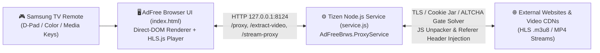

<div align="center">

# 🛡️ AdFree Browser Pro for Samsung Smart TV (Tizen OS)

**The Fast, 100% Ad-Free Web Browser & Universal Video Stream Player Built Specifically for Samsung Smart TVs (Tizen 4.0 – 9.0+)**

[](https://github.com/yummi-gb/AdFree-Browser-Pro/releases)
[](https://github.com/yummi-gb/AdFree-Browser-Pro)
[](https://github.com/yummi-gb/AdFree-Browser-Pro)
[](https://github.com/yummi-gb/AdFree-Browser-Pro)
[](LICENSE)

[**⬇️ Download Latest `.wgt` Package (Releases)**](https://github.com/yummi-gb/AdFree-Browser-Pro/releases) • [**✨ Features**](#-key-features) • [**🚀 Easy Installation**](#-installation-guide-3-easy-methods) • [**🎮 Remote Controls**](#-tv-remote-control-shortcuts) • [**🏗️ Architecture**](#️-system-architecture)

</div>

---

## 🌟 Why AdFree Browser Pro?

The stock browser on Samsung Smart TVs is slow, cluttered with pop-ups, breaks on video streaming portals, and consumes hundreds of megabytes of RAM in the background.

**AdFree Browser Pro (`v1.1.5`)** is a lightweight, homebrew Tizen TV web browser and universal media streamer engineered from the ground up for **Samsung QLED, Neo QLED, OLED (S90C / S90D / S95D), Frame, and Crystal UHD TVs**.

### ✨ Key Features

- 🚫 **Zero Pop-Ups & Built-In AdBlocker:** Strips ad scripts, pop-unders, overlay hijacks, and tracking beacons *before* they ever render on your TV.
- 🎬 **Universal Video Stream Extractor (Play Anything):**
  - Automatically detects and extracts direct **HLS (`.m3u8`)** and **MP4 (`.mp4`)** streams from embedded video players and streaming hosts (**VOE, Vidmoly, Filemoon, Streamtape, Vidoza, Supervideo, Speedfiles, Luluvdo, Doodstream, HTML5 Video, JWPlayer, PlayerJS**, and packed JS embeds).
  - **Language-Aware Multi-Hoster Auto-Fallback:** If a clicked stream mirror is offline or blocked, the player automatically switches to the next working mirror in your chosen language (`Deutsch` / `Englisch`) without interruption.
  - **Built-In ALTCHA / Redirect Gate Solver & CORS Stream Proxy:** Automatically resolves proof-of-work redirect gates and proxies `Referer`-locked HLS/MP4 streams locally on the TV.
- ⛶ **True Chrome-Style Fullscreen (Zero Visible Bars):**
  - Press the **Red Button** on your remote (or click `⛶ Vollbild`) to enter 100% edge-to-edge fullscreen.
  - Both the top browser bars and the video timeline HUD + cursor automatically fade out after **2.5 seconds** of inactivity. Move the cursor to the top edge (`Y < 28px`) at any time to peek at your tabs and address bar.
- 🖱️ **Precision Remote Control Virtual Mouse & Smart Website Search:**
  - Smooth D-Pad virtual cursor that never gets trapped inside iframes.
  - Clicking **any search icon, search bar, or input field** on any website (even single-page apps and modal-based search bars without `<form>` tags) opens a big, TV-friendly On-Screen Keyboard and navigates directly to the search results upon pressing `OK ✔️` or `LOS 🚀`.
- ⚡ **Ultra-Low RAM Footprint & Auto-Suspend:**
  - Engineered to protect your TV's memory: automatically pauses media decoding and releases background resources the moment you press the Samsung *Home* button (`background-support="disable"`).

---

## 📊 Comparison: AdFree Browser Pro vs. Stock Samsung Internet

| Feature | 🛡️ AdFree Browser Pro | 🌐 Stock Samsung Browser |
| :--- | :---: | :---: |
| **Pop-Up & Overlay Ad-Blocking** | ✅ **100% Blocked at DOM & Network Level** | ❌ Frequent pop-ups & redirect ads |
| **Direct HLS (`.m3u8`) & `.mp4` Extraction** | ✅ **Automatic Native TV Player** | ❌ Fails or stutters inside ad-heavy iframes |
| **Multi-Hoster Auto-Fallback** | ✅ **Automatic (Language-Aware)** | ❌ Manual reload required |
| **Cursor Inside Video / Web Containers** | ✅ **Never gets stuck in iframes** | ❌ Cursor freezes inside nested iframes |
| **Chrome-Style Auto-Hide Fullscreen** | ✅ **100% Screen (0px bars)** | ⚠️ Persistent top/bottom UI bars |
| **Background RAM Usage When Closed** | ✅ **0 MB (Auto-Suspends on Exit)** | ❌ Stays resident in RAM (~250+ MB) |

---

## 🎮 TV Remote Control Shortcuts

| Remote Button | Action in Browser Mode | Action in Video Fullscreen |
| :--- | :--- | :--- |
| **D-Pad (Up / Down / Left / Right)** | Move virtual mouse cursor (accelerates when held) | Seek `-15s` / `+15s` (Left/Right) or wake HUD (Up/Down) |
| **OK / Enter Button** | Click element under cursor / Open TV Keyboard on inputs & search icons | Play / Pause video (or click HUD button if hovered) |
| **🔴 Red Button** | Toggle **Video Fullscreen** (if video active) or **Chrome Browser Fullscreen** | Exit Fullscreen |
| **🟢 Green Button** | Open a **New Tab** | Open a New Tab |
| **🟡 Yellow Button** | Open **On-Screen TV Keyboard** (URL / Search) | Open On-Screen TV Keyboard |
| **🔵 Blue Button** | Open **Favorites & Browsing History** | Open Favorites & History |
| **CH ⬆️ / CH ⬇️ (Channel Up/Down)** | Smooth page scroll Up / Down (`550px`) | Smooth page scroll |
| **⏯️ Play/Pause / ⏪ / ⏩** | Control active video stream on page | Play/Pause or Seek `-15s` / `+15s` |
| **↩️ Back / Return Button** | Exit Fullscreen → Navigate Back in Tab → Exit App | Exit Video Fullscreen |

---

## 🚀 Installation Guide (3 Easy Methods)

### Prerequisites: Enable Developer Mode on Your Samsung TV
1. On your Samsung TV, open the **Apps** screen from the Smart Hub home menu.
2. Using your remote, enter the PIN sequence **`1` `2` `3` `4` `5`**.
3. Toggle **Developer Mode** to **ON** and enter the IP address of your PC.
4. **Restart your TV** (hold the Power button on the remote for 5 seconds until the Samsung logo appears).

---

### Method 1: 1-Click Install via Jellyfin2Samsung / TizenSDB (Recommended & Easiest)
1. Download the latest **`AdFreeBrowser_v1.1.5.wgt`** from the [**Releases**](https://github.com/yummi-gb/AdFree-Browser-Pro/releases) page (or from the [`releases/`](releases/) folder in this repository).
2. Open [**Jellyfin2Samsung**](https://github.com/PatrickSt1991/Samsung-Jellyfin-Installer) (or any Tizen WGT Installer tool), select **Custom WGT**, choose `AdFreeBrowser_v1.1.5.wgt`, enter your TV's IP address, and click **Install**.
   *(The tool will automatically re-sign the `.wgt` package with your TV's certificate and install it in seconds!)*

---

### Method 2: Install via Tizen Studio CLI (`sdb`)
If you already have Tizen Studio (`sdb` and `tizen` CLI) installed on your computer:

```bash
# 1. Connect to your Samsung Smart TV
sdb connect <YOUR_TV_IP>:26101

# 2. (Optional) Re-sign the package with your own Tizen author/distributor certificate profile
tizen package -t wgt -s <YOUR_CERT_PROFILE> -- AdFreeBrowser.wgt

# 3. Push & install onto the TV
sdb push AdFreeBrowser.wgt /home/owner/share/tmp/sdk_tools/AdFreeBrowser.wgt
sdb shell 0 vd_appinstall AdFreeBrws.AdFreeBrowser /home/owner/share/tmp/sdk_tools/AdFreeBrowser.wgt
sdb shell 0 rm /home/owner/share/tmp/sdk_tools/AdFreeBrowser.wgt
```

---

### Method 3: Build from Source
1. Clone this repository:
   ```bash
   git clone https://github.com/yummi-gb/AdFree-Browser-Pro.git
   cd AdFree-Browser-Pro
   ```
2. Zip the core files (`config.xml`, `index.html`, `service.js`, `hls.min.js`, `icon.png`) into `AdFreeBrowser.wgt`:
   ```powershell
   Compress-Archive -Path config.xml,index.html,service.js,hls.min.js,icon.png -DestinationPath AdFreeBrowser.zip -Force
   Move-Item AdFreeBrowser.zip AdFreeBrowser.wgt -Force
   ```
3. Sign and deploy using `TizenSdb` or `tizen package`.

---

## 🏗️ System Architecture

AdFree Browser Pro uses a **hybrid Tizen Web UI + Background Node.js Service (`AdFreeBrws.ProxyService`)** architecture to bypass cross-origin (CORS) blocks, `X-Frame-Options` restrictions, redirect gates, and `Referer`-locked video CDNs directly on the TV:



---

## 🔍 Topics & Keywords

`samsung-tv` • `tizen` • `tizen-tv` • `samsung-smart-tv` • `adblock-browser` • `tizen-homebrew` • `smart-tv-browser` • `hls-player` • `voe-extractor` • `stream-extractor` • `tizen-wgt` • `samsung-oled-s90d` • `tizen-studio`

---

## 📜 License

Released under the [MIT License](LICENSE). Contributions, issue reports, and pull requests are welcome! If this project makes your Samsung TV faster and ad-free, please give it a **⭐ Star** on GitHub!
